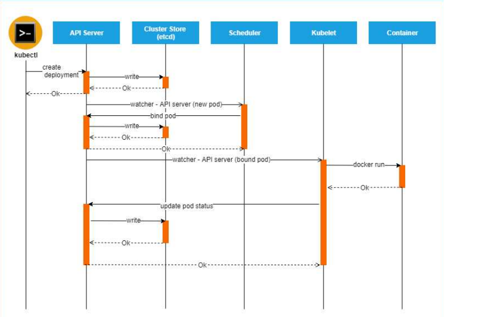

# k8s-04 · Теория

Вопросы с ответами из [theory/interview.md](../../../theory/interview.md), относящиеся к этой задаче.
Файл собирается автоматически (`python3 theory/build.py`): правь ответы в interview.md, а список вопросов — в theory/tasks.map.

**Вопросы:**

1. Что такое Requests, Limits, про QOS ?
2. что произойдет с контейнером, если будет превышен лимит по памяти или по CPU?
3. если лимит больше чем реквест и нету ресурсов на ноде и выложиться ли такой под
4. Что такое PersistentVolume, PersistentVolumeClaim
5. Что такое Volume
6. Какие бывают типы файловых хранилищ
7. Что такое nodeSelector, nodeName?
8. Что такое Taints, Tolerations?
9. Affinity, anti-affinity**
10. Как создается под? Какие компоненты задействуются при его создании?

---

## Что такое Requests, Limits, про QOS ?

- Ответ
    
    В спецификации пода мы можем указать плановое потребление ресурсов(requests) и лимиты использования ресурсов(limits). Нужный узел подбирается автоматически с учетом текущей нагрузки.
    
    cpu: 50m - m -milicpu. 
    
    limits - контейнер будет убить. Непредсказумая настройкая.
    
    Есть QoS классы подов
    
    - Guaranteed (limits = requests) //Под не может превысить свои ресурсы. Сколько запросил столько и получил
    - Burstable (limits > requests) кто-то запросил 50 цпу, но иногда превышает его. И часть контейнеров при нагрузке будут переезжать
    - BestEffort (не указаны limits и requests) - не указываем лимиты реквесты. Первыми будут переезжать эти
    
    Можно увидеть через describe пода

---

## что произойдет с контейнером, если будет превышен лимит по памяти или по CPU?

Если будет превышен лимит по памяти то под будет убит OOMkiler ом

если будет превышен лимит по CPU то приложения начнет тролит механизмом CFS LINUX ( completeley fair schedule )
со стороны это может выглядеть так что начнут падать Liveness, redines пробы потому что буквально не будет выделяться какое то окно CPU для приложегния
и дальше контейнер уже может быть перезапущен
либо со стороны клиента так же выглядит как большие таймауты, будет работать медленно нестабиольно мб 500тить уже по тайматом и тд

---

## если лимит больше чем реквест и нету ресурсов на ноде и выложиться ли такой под

- Ответ
   
   да, ведь по реквесту под может развернуться, но как только под будет требовать ресурсов больше чем есть на ноде то под убьеться (этот процесс называется оверкомит, и как в линуксе есть что каждый процесс может запуститься но потом убьется если будет тербовать много ресурсов)

---

## Что такое PersistentVolume, PersistentVolumeClaim

- Ответ
    
    **PersistentVolume (PV)**  - ресурс кластера, как бы кусок какого то постоянного хранилища.созданный админом или динемически через Storageclass который живет вне жизненного цикла пода. - 
    Примеры: NFS, RBD, CephFS и другие.
    
    **PersistenceVolumeClaim(PVC)**  - запрос к PV от приложения на выделение места под хранение данных с требованями аля размер, правила доступа и тд. куб в свою очредь выбирает подходяшитй PV или создает новый через storageclassб. так же сам под конкретно цепляется не к PV а к PVC
    
    **StorageClass** - это по факту описания правила того как будет динамически провижиониться PV по запросу PVC (какой provisioner и какие настройки использовать для создания PV под PVC)

    - Объем места
    - Тип доступа
    
    **Типы доступа у PVC**:
    
    - **ReadWriteOnce** - том может быть смонтирован на чтение и запись к одному поду
    - **ReadOnlyMany** - том может быть смонтирован на много подов в режиме реального времени
    - **ReadWriteMany** - том может быть смонтирован к множеству подов в режиме чтения и записи

- Схема статической и динамической
    
    
    
    **Статическое**.
    
    Сторадж это хранилище. Диск, облачный ресурс.
    
    Для того, чтобы к поду подмонтировалась часть пространства, администратор должен создать набор PersistanceVolume. Допустим диск на 500гб, админ нарезает его с помощью PersistanceVolume на блоки. По 10, 20, 50 гб. И так далее. Короче набор таких PV.
    
    Когда поду нужно место PVC делает заявку о том, что ему нужен диск определенного размера с определенным типом доступа. И кубер подбирает подходящие PV. И не всегда запрос совпадает с тем, что есть. Допустим, у нас нарезано по 100гб PV, а PVC запрашивает на 5 гб, то кубер отдаст на 100. Других вариантов нету просто. Нужно оптимиально их разбивать.
    
    Эту проблему решает динамическая схема создания.
    
    **Динамическое**
    
    Здесь плагин сам формируует PV при наличии запроса на него.
    
    Админ создает сторадж класс, где описывается сторадж, который подключил к кластеру. Ну и с помощью плагина в ответ на запрос pvc кубер создаст pv нужного размера, и предоставит для пода.

  - если коротко
    - статически: создаешь pv размера 10гб ( для примера ), pvc запрашивает 1гб, ищет подходящие pv в кубе видит что есть на 10 гб, аттачит к нему ( проблемы статических pv )
    - динамически: создается storageclass где описывается от куда брать дисковые ресурсы, создается pvc и с помощью плагина для этого pvc автоматически создается pv нужного размера ( на pvc 1 гб создасться pv 1 гб )

---

## Что такое Volume

- Ответ
    
    Volume - это абстракция файлового хранилища.
    
    Решает следующие основные проблемы:
    
    - Файловая ситема контейнера существует только до его удаления или перезапуска
    - Некоторым контейнерам нужно общее пространство для хранения файлов, или для обращения к конфигурационным файлам.
    - Изолирует приложение от технологий хранения данных
    
    Живет только с подом

---

## Какие бывают типы файловых хранилищ

- Ответ
    
    **emptyDir**
    
    Каталог, который создается до пода, и и живет пока под не будет удален. Все контейнеры в нем могут читать данные из этого volume.
    
    В качестве системы хранения - используется файловая система узла.
    
    **hostPath**
    
    В hostpath папка на узле уже существует, и подключается к подам. Данные не пропадают после удаления пода.
    
    В случае с emptyDir создается папка, подмонтируется. Если под падает - данные пропадают.
    
    Используется для случаев, когда под отслеживает состояние узла. Предоставляется доступ к системным каталогам
    
    Также там есть ключи DirectoryOrCreate и FileOrCreate - они нужны для задачи кубернетесу проверить наличие папки, и потом обращение к файлу.

---

## Что такое nodeSelector, nodeName?

- Ответ
    
    Это тип балансировщика.
    
    В спецификации пода указываются метки узлов (nodeSelector), на которых мы хотим его запустить или указывается определенный узел (nodeName)
    
    Например
    
    ```
    # Данный под будет назначен на узел, где есть специфический тип диска
    nodeSelector:
      disktype: ssd
    
    # можем указать название узла куда под должен быть направлен
    nodeName: kube-01
    ```

---

## Что такое Taints, Tolerations?

- Ответ
    
    Можно настроить список блокировок (taints). Или как зараза. И если в спецификации пода не указана сопротивляемость к блокировкам(tolerations), то он не сможет попасть на определенный узел.
    
    То есть мы говорим поду где НЕ запускаться.
    
    Виды блокировок:
    
    **NoSchedule**
    
    Не размещать на узле без соответсвующих tolerations, поды которые уже работают на узле, не будут затронуты.
    
    **PreferNoSchedule**
    
    Предпочитать не размещать на узле поды без соответствующих tolerations, но  не требовать этого.
    
    **NoExecute**
    
    Не размещать на узле поды без соответствующих tolerations. все поды которые уже есть на 
    ноде с таким taint и не будут иметь соответствующие tolerations, будут мувнуты с нее на другю ноду.

---

## Affinity, anti-affinity**

- Ответ
    
    В спецификации пода указываются требования и пожелания к узлам, а также к уже существующим подам.
    
    Как нод селектор. Но можно заказать условия. Типа метка может быть определенных типов, перечисленных.

    **example**:

    ```yaml
    affinity:
        nodeAffinity:
          requiredDuringSchedulingIgnoredDuringExecution:
          #параметр выше отвечает за то, что эти правила бдуут применяться при планировки а не при работе нод и тд
            nodeSelectorTerms:
            - matchExpressions: #disktype должен быть не hdd
              - key: disktype
                operator: NotIn
                values:
                - hdd
            - matchExpressions: #RAM памяти должено быть больше чем 8гб на ноде 
              - key: memory
                operator: Gt
                values:
                - 8Gi
            - matchExpressions: #gpu должн обыть на ноде
              - key: gpu
                operator: Exists
      podAntiAffinity:
      requiredDuringSchedulingIgnoredDuringExecution:
      - weight: 100 #позволяет задать вес правилу и там самым можно управлять их приоритетностью
        podAntiAffinityTerm:
          labelSelector:
            matchExpressions: #в целом это правило указываеьт что бы поды с меткой app = web-app были на разных хостах
            - key: app
              operator: In
              values:
              - web-app
          #topologyKey позволяет указать на каком уровне будут применяться правила, здесь на уровне  хоста
          topologyKey: kubernetes.io/hostname 
      podAffinity:
        requiredDuringSchedulingIgnoredDuringExecution:
        - podAffinityTerm:
            labelSelector: 
              matchExpressions: #лейбл security должен быть = s1 на поде
              - key: security
                operator: In
                values:
                - s1
            topologyKey: kubernetes.io/hostname
    ```

---

## Как создается под? Какие компоненты задействуются при его создании?

- Ответ

    Предварительная информация.
    Воркер узлы состоят из трех компонентов.
    kubelet - это модуль коммуникации сервера с kubeapi.  
    Он сообщает информацию о себе в куб апи. И принимает ее оттуда же.
    CRI - container runtime engine - штука, которая непосредственно создает контейнер.
    proxy kube server - нужен для взаимодействия узлов между собой, например, когда вычислительные мощности требуют задействовать более, чем один узел.

    Первое что задействуется - команда kubectl.
    Далее оно попадает на kubeAPI.
    KubeAPI - является основным компонентом управления кластером кубера.

    Далее kubeapi аутентифицирует и валидирует запрос. Проверит кто делает запрос, и проверит есть ли у запрашиваемого доступ к кластеру.

    опрашивает controle manager есть ли ресурсы и тд

    Далее апи сервер запишет этот под в etcd.
    Etcd - это хранилище данных, которое распределено по кластеру, и является "точкой правды" для кластера кубера.
    Далее etcd возвращает ответ в апи о том, что под создан. Но по факту пока что еще ничего не создано кроме записи в базе.

    Далее в дело вступает планировщик, scheduler. Он следит за нагрузкой которую необходимо создать.
    Он определяет на какую ноду можно разместить тот или иной под.
    Он периодически опрашивает куб апи на предмет наличия задач. 
    Шедулер создает поды на воркер узлах, и смотрит на доступные вычивлительные мощности, место и на ограничения. 
    После того, как он определяет где можно создать подходящий под, он сообщает об этом в kubeAPI.

    kubeapi обращается в kubelet той ноды, на которую указал шедулер, как на подходящую.
    kubelet работает вместе с CRI, который создаст под, в котором работает контейнер.

    если коротко цепочка запросов

    kubectl -> kubeapi -> controle manager -> kubeapi -> etcd -> kubeapi -> kube scheduler -> kubelet


    


    
