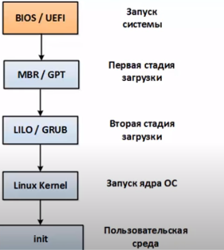

# linux-14 · Теория

Вопросы с ответами из [theory/interview.md](../../../theory/interview.md), относящиеся к этой задаче.
Файл собирается автоматически (`python3 theory/build.py`): правь ответы в interview.md, а список вопросов — в theory/tasks.map.

**Вопросы:**

1. Расскажи, как происходит процесс загрузки ОС linux с момента нажатия кнопки питания.
2. Что за процессы в Linux c PID 0 и 1
3. Что такое уровни выполнения (run levels) в Linux
4. Зачем нужна система инициализации? Какие системы инициализации используются в современных дистрибутивах? (2 - 5 штук) (init)
5. Что такое systemd и init ? В чем основное преимущество первого над вторым ?

---

## Расскажи, как происходит процесс загрузки ОС linux с момента нажатия кнопки питания.

- Процесс загрузки системы
    
    Этапы следующие
    
    
    
    1. При включении компьютера цп переходит на адрес биоса и загружает биос.  
    2. Биос, или uefi проходит кучу проверок и согласно своим проверкам носитель информации.  
    3. На носителе находится MBR или GPT где находится загрузчик. Дальше по обстоятельствам. Загрузчик может загружать ось, а может передать управление дальше. 
       Например, если у нас есть несколько систем на нескольких разделах.  
       Под первой частью загрузки подразумевается небольшая часть машинного кода, которая запускает второй загрузчик. Потому что выделяется 446 байт. Там ничего не поместится.   
    4. Итого загрузчик первого этапа загружает загрузчик второго и кладет данные в оперативку. 
       Загрузчик, зная где лежит загрузчик ос, грузит его, и грузит initial ram disk - там лежат модули ядра. Они также являются драйверами, которые необходимы для загрузки всей остальной системы.   
    
    1. Затем ядро берет всё на себя. Инициализация устройств, конфигурирование процессора, памяти
    2. Далее запускается пользовательская среда, процесс init
    

    

    **супер коротко**
    1. загрузка биоса либо UEFI.
    2. биос либо UEFI проверяет работоспособность всех компонентов и запускает бутлоадер, 
       ищет его в  MBR или GPT разделе на диске.
    3. бутлоадер грузит OS.
    4. она уже грузит ядро.
    5. ядро конфигурирует уже всю память, процессор и тд.
    6. ядро запускает init процесс.
    8. запускаются все сервисы.
    9. логин в систему.
    7. запускаются скрипты оболочки юзера аля .bashrc, .zshrc, zprofile и тд.
    

    Полная подробная по загрузке пк вы можете увидеть по ссылке:
    [https://vc.ru/dev/137548-pusk-v-detalyah-kak-zagruzhaetsya-server](https://vc.ru/dev/137548-pusk-v-detalyah-kak-zagruzhaetsya-server)

---

## Что за процессы в Linux c PID 0 и 1

- Ответ
    Процесс с PID 0 - это процесс swap (или идл процесс).
    
    Этот процесс не выполняет никаких задач, он является бездействующим.
    Процессор переходит к выполнению процесса 0, когда нет других активных процессов для выполнения.
    
    
    Процесс с PID 1 - это init процесс (или systemd в современных дистрибутивах Linux).
    
    Это первый процесс, который запускается во время загрузки системы после ядра Linux.
    Он является родительским процессом для всех остальных процессов в системе.
    init процесс отвечает за запуск различных системных служб и демонов при загрузке.
    Если init процесс завершается, это приводит к остановке всей системы.

---

## Что такое уровни выполнения (run levels) в Linux

- Ответ

    В Linux существует понятие **уровень выполнения** (*run level*), который обозначается числами от 0 до 6. Каждый уровень выполнения соответствует определённому состоянию системы.
    
    Система в любой момент времени находится на определённом уровне выполнения. Как системный администратор, вы можете переводить её с одного уровня выполнения на другой с помощью программы `init` (или `telinit`), передавая в качестве аргумента число, соответствующее нужному уровню выполнения.
    
    ### Описание уровней выполнения
    
  - **0** — система выполняет действия по выключению.
  - **1** — **однопользовательский режим** (*single user mode*). Предназначен для административных задач, например, восстановления системы. По функциональности напоминает безопасный режим (*Safe Mode*) в Windows, однако не является его полной аналогией. В этом режиме система сконфигурирована, но не запущен ни один сервис, и может работать только один пользователь — `root`.
  - **2** — **многопользовательский режим без сетевых файловых систем**. Не используется во многих дистрибутивах, но в Debian используется как стандартный многопользовательский режим.
  - **3** — **многопользовательский режим с сетевыми возможностями**. Это нормальный режим работы сервера без графического интерфейса.
  - **4** — **не используется** в большинстве систем. В Slackware Linux используется для графического входа в систему.
  - **5** — **графический режим**. В RedHat и SuSE Linux этот уровень используется для графического входа в систему. В Slackware не сконфигурирован.
  - **6** — выполняются действия по перезагрузке системы.

   ### Примечания к уровням выполнения
  - В большинстве современных систем уровни выполнения заменены на **systemd targets**, но принцип остаётся аналогичным.

---

## Зачем нужна система инициализации? Какие системы инициализации используются в современных дистрибутивах? (2 - 5 штук) (init)

- Ответ
    
    В операционной системе Linux и других системах семейства Unix после завершения загрузки ядра начинается инициализация Linux системы, сервисов и других компонентов. За это отвечает процесс инициализации, он запускается ядром сразу после завершения загрузки, имеет PID 1, и будет выполняться пока будет работать система.
    
    За время развития операционных систем были созданы различные системы инициализации Linux. В разных дистрибутивах использовались разные системы
    
    Есть init. Это первый процесс, родительский процесс, которые все процессы запускает. Проверка, монитрование файловых систем, запуск служб.
    
    Есть три его варианты работы
    
    **System V init (SysV)**
    
    Это загрузка, основанная на уровне запуска. Обычно их семь. Ну там включение, выключение, режим восстановления и тп.
    
    То есть процесс инициализирует на одном из уровней запуска системы
    
    **SystemD**
    
    Родительский процесс, который запускает инициализацию в ускоренном режиме за счет параллельного запуска задач. Ускоренный режим достигается за счет особенностей работы процессора. И если они позволяют, запускает инициализацию параллельно.
    
    **Upstart**
    
    Здесь запускаются скрипты инициализации, отслеживает события, и реагирует на них. Более гибкий процесс инициализации. Если какая-то служба не запустилась, или вдруг упала, то апстарт это отследит и запустит повторно.

---

## Что такое systemd и init ? В чем основное преимущество первого над вторым ?

- Ответ
    И то, и то система инциализации.
    
    В чём конкретно преимущества для меня systemd над init:
    
    - Параллельный старт процессов, в отличие от init
    - Запуск системы с ним быстрее происходит.
    - Не нужно городить костыли на баше — использую простенький
    шаблон для юнитов, в отличие от баш портянки.
    - Не нужно городить километровые пайпы для чтения нужной информации из логов — для всего есть человекопонятные опции;
    - Автоматический рестарт юнитов при падении — не нужно плясать с бубном вокруг ряда сервисов, если выпал один промежуточный;
    - Простая и понятная настройка всего — несколько конфигов (а не тонны, раскиданные по всей системе, как было в легаси) с парами
    ключ=значение;
    - Хорошая документированность (я не говорю, что легаси-набор плохо документирован, я лишь говорю, что systemd не уступает);
    - Он не только загрузчик, но и система инициализирующая демоны
